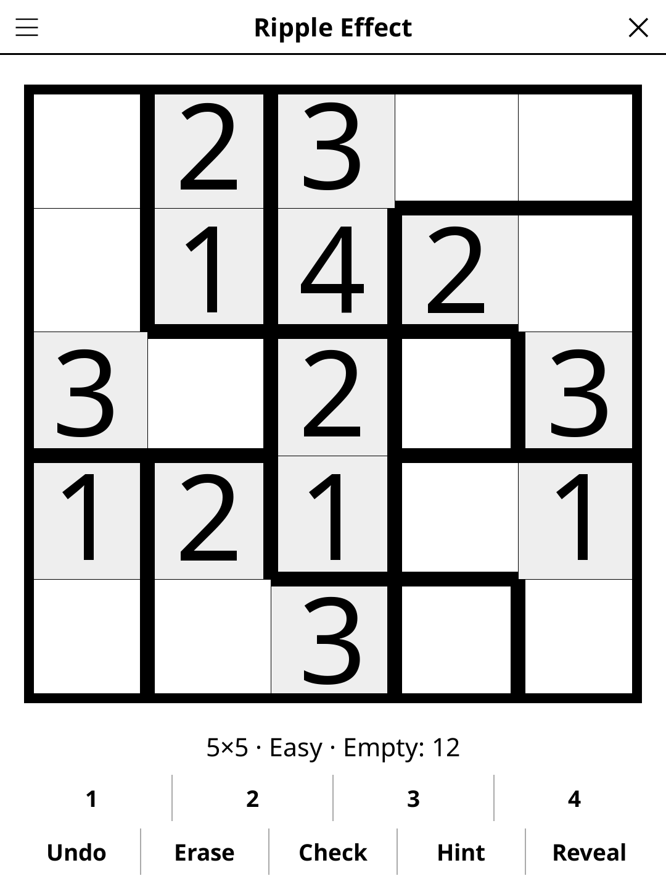

# rippleeffect.koplugin

A Ripple Effect puzzle plugin for [KOReader](https://github.com/koreader/koreader).

## Screenshot

## Rules

Fill every cell so that each outlined region of size N contains 1–N exactly once. Additionally, if the same number appears twice in the same row or column, there must be at least that many cells between them (two 3s need three cells in between: the "ripple" constraint).

## Features

- **Multiple grid sizes**
- **Three difficulty levels** — Easy needs only the basic rules (equal digits never touch); Medium adds the long reach of 2s, 3s and 4s along rows and columns; Hard shows almost no digits and needs many more of those steps. Every puzzle has a single solution and can be solved by logic alone, without guessing
- **Region highlighting** — outlined regions are clearly shown
- **Check** — highlights rule violations
- **Hint** — two taps: the first says which cell is about to give, the second acts on it. A cell that contradicts the solution is always reported before a fresh one is revealed
- **Auto-save** — puzzle state saved and restored on next launch

## Installation

1. Download `rippleeffect.koplugin.zip` from the [latest release](../../releases/latest).
2. Extract into the `plugins/` folder of your KOReader data directory.
3. Restart KOReader.
4. Open the menu → **Tools** → **Ripple Effect**.

## Controls

| Action | How |
|--------|-----|
| Select a cell | Tap it |
| Enter a number | Tap the digit button |
| Erase a cell | Tap **Erase** |
| Check progress | Tap **Check** |
| New puzzle | Tap **New game** |
| Show rules | Tap **Rules** |

## License

GPL-3.0 — see [LICENSE](LICENSE).
